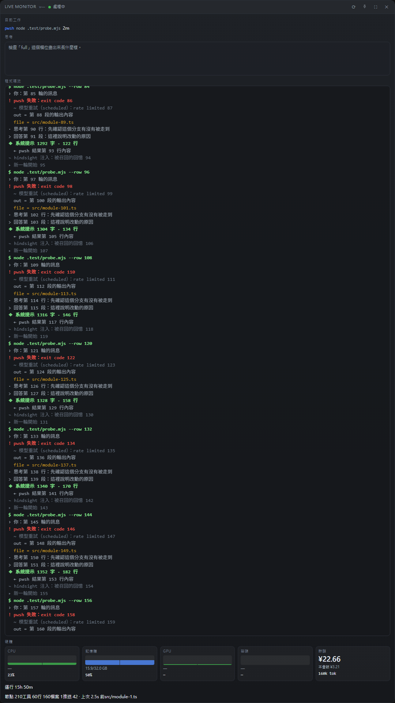
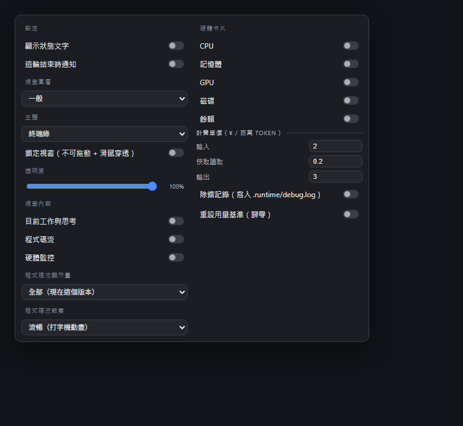

# dsh-status-badge

輸入框下方的狀態列 + 可展開的三層即時監控視窗（給 DeepSeek Harness 用的社群外掛）。





## 這是什麼

- **狀態列**：貼在輸入框下方，一個圓形指示燈 + 一句話說明 agent 現在在做什麼（閒置中 / 思考中 / 編寫中 / 修改中 / 執行工具中 / 等你回應）。
- **懸停設定卡**：滑到狀態列上，右側出現齒輪，展開後可以調顯示文字、脈動、結束通知、視窗圖層（置頂 / 置底 / 一般）、釘選位置、滑鼠穿透、透明度。
- **監控視窗**：點狀態列開一個無邊框透明視窗，三層內容：
  1. 目前工作 + 模型思考串流
  2. 終端式程式碼流（真實工具呼叫優先，沒資料時補示範行）
  3. 硬體監控（CPU / 記憶體 / 每張 GPU / 磁碟 / 網路 / 電池 / top 進程）

## 需求

- Windows（硬體數據靠 `powershell.exe` 的 `Get-Counter` 與 CIM，Windows 內建，不用裝別的）
- DeepSeek Harness **解包版**（`resources/app/` 目錄存在）。asar 打包版改不到外殼主進程，監控視窗無法建立。
- Node 22+

## 安裝

### 0. 取得原始碼

```bash
git clone https://github.com/jims5115s-maker/dsh-status-badge.git
```

### 1. 掛進 DSH

```bash
# 在 DSH 裡用 plugin_manager 安裝這個目錄，或直接複製到 profile 的 plugins 下
```

### 2. 打外殼補丁（監控視窗必需）

`window.open` 在這個外殼裡被 renderer 層擋死（回 `null`，`setWindowOpenHandler` 根本收不到），所以視窗必須由 Electron 主進程直接建立。安裝器會把一小段 bridge 插進外殼的 `main.js`：

```bash
node .test/install-shell.cjs "D:/path/to/DeepSeek/resources/app/lib/main.js"
```

安裝器是幂等的：重複執行會先剝掉舊區塊再插入，不會疊加。DSH 更新覆蓋 `main.js` 後重跑一次即可。

跑完重啟 DSH，bridge 的埠號會寫到 `.runtime/bridge.port`。

## 移除外殼補丁

把 `main.js` 裡 `/* __statusBridgeV2:start */` 到 `/* __statusBridgeV2:end */` 之間整段刪掉，再把啟動掛鉤還原成原本的 `})) app.whenReady().then(main).catch(`。

## 檔案

| 檔案 | 作用 |
|---|---|
| `client.js` | 狀態列、設定卡、內嵌面板備援（DSH client slot 外掛） |
| `index.js` | host 半部：`/status-badge/*` 路由、硬體取樣、bridge 代理 |
| `window.html` | 監控視窗頁面（三層排版、程式碼流播放器） |
| `cordis.patch.yml` | bundle 掛載宣告 |
| `locale/*.json` | 字典（en / zh-TW / zh-CN） |
| `.test/install-shell.cjs` | 外殼 bridge 安裝器 |
| `.test/bridge-block.js` | 要插入外殼的 bridge 原始碼（含路徑 token） |
| `.test/extract-block.cjs` | 從已打補丁的 `main.js` 反向抽出 bridge（維護用） |
| `.test/render.test.mjs` | 純函式與元件測試（`node --test`） |

## 執行測試

```bash
node --test .test/render.test.mjs
```

## 已知限制

- 視窗標題列是外殼自繪，無法完全去掉（本專案用 `frame:false` + `transparent:true`，正常情況下沒有系統標題列）。
- 「點擊穿透」開啟後視窗就點不到了，要從 DSH 的設定卡關掉。
- 透明度只作用在背景板與邊框，文字保持不透明。
- 多螢幕時，若記住的位置落在主螢幕外，開窗會自動置中。

## 授權

MIT

## 版本規則

從 `1.0.0` 開始，每次改動進一位：`1.0.1` → … → `1.0.9` → `1.1.0` → … → `1.9.9` → `2.0.0`。

```powershell
node .test/bump-version.cjs          # 進一位並寫回 package.json
node .test/bump-version.cjs --show   # 只看目前版本
```

版本會自動顯示在監控視窗標題列（`LIVE MONITOR v1.0.0`），來源是 `GET /status-badge/metrics` 的 `version` 欄位，該欄位讀自 `package.json`。
